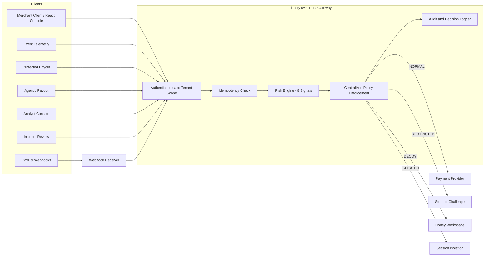

# IdentityTwin — Behavioral Identity & Trust Gateway

> Continuous behavioral risk assessment and policy-enforced trust gateway for merchant payment operations.

## 1. Executive Summary & Mission

IdentityTwin prevents account takeover, credential stuffing, session hijacking, and unauthorized money movement in merchant payment operations.

Traditional authentication systems verify identity primarily at login. However, a successful login does not guarantee that subsequent actions are legitimate. A compromised session can remain active even after an attacker gains access to an account.

IdentityTwin addresses this gap by continuously assessing behavioral and transactional signals and routing sensitive operations through a centralized Trust Gateway with four enforced trust levels.

The platform includes:

- Core FastAPI application with structured logging, consistent error contracts, and OpenAPI 3.1.
- Centralized Trust Gateway enforcing NORMAL, RESTRICTED, DECOY, and ISOLATED trust levels.
- Protected payout execution with database-backed idempotency.
- Payment provider adapters: `MockPaymentProviderAdapter`, `PayPalSandboxAdapter`, and `DecoyHoneyAdapter`.
- Behavioral telemetry ingestion through `POST /v1/events`, using eight deterministic risk signals.
- PayPal webhook receiver with signature verification and reconciliation.
- Incident review and approval APIs with role-based access control.
- Honey Workspace with synthetic decoy environments and canary detection.
- Evidence Chain with hash-chained append-only logs.
- Agentic Commerce with server-side authorization grant validation.
- Reconciliation Worker using PostgreSQL concurrency controls.
- Durable Domain Events with tenant-scoped SSE streams.
- React 19 + TypeScript Operations Console with 17 routes.
- AI-powered incident investigation using Groq's LLM inference API.

### Test coverage

- **Backend:** 635 passed in the reported run; 13 PostgreSQL-dependent reconciliation tests and one migration-path test have separate execution requirements.
- **Frontend:** 20/20 unit tests passed.
- **E2E:** 12 Playwright tests.
- **Security invariants:** 18/18 documented as verified.
- **Database migrations:** 19 migrations.

## 2. Architecture & Trust Gateway Policy

IdentityTwin uses a centralized Trust Gateway to ensure that every protected operation follows authentication, idempotency, risk evaluation, policy enforcement, and audit logging.



### Trust levels

| Trust level | Risk score       | Action            | Behavior                                          |
| ----------- | ---------------- | ----------------- | ------------------------------------------------- |
| NORMAL      | 0–29.9           | `ALLOW`           | Transaction proceeds through configured provider  |
| RESTRICTED  | 30–59.9          | `REQUIRE_STEP_UP` | Sensitive actions require additional verification |
| DECOY       | 60–89.9          | `DECOY_FORWARD`   | Activity is routed to a synthetic honey environment |
| ISOLATED    | 90–100 or Canary | `BLOCK`           | Payout is blocked and the session is isolated     |

### Behavioral risk signals

| Signal                   | Weight | Description                              |
| ------------------------ | ------ | ---------------------------------------- |
| `NEW_DEVICE`             | 18     | Unrecognized device fingerprint          |
| `NEW_LOCATION`           | 14     | Unfamiliar network origin                |
| `UNUSUAL_TIME`           | 11     | Activity outside established usage hours |
| `NEW_PAYEE`              | 16     | Previously unseen recipient              |
| `LARGE_PAYOUT`           | 21     | Payout exceeds configured thresholds     |
| `NEW_PAYEE_LARGE_PAYOUT` | 9      | New recipient combined with large payout |
| `PAYEE_ADD_THEN_PAYOUT`  | 9      | Payee addition followed by a payout      |
| `CANARY_INTERACTION`     | 11     | Interaction with a synthetic resource    |

## 3. AI Investigator — Groq-Powered

IdentityTwin integrates Groq's LLM inference API to generate advisory investigation narratives using structured, redacted security evidence.

### How it works

1. An analyst opens a suspicious incident in the React console.
2. The analyst selects **Run Investigation**.
3. The backend extracts merchant-scoped evidence from the database.
4. Sensitive information is redacted through allowlisted projections and sanitization.
5. The structured evidence is sent to Groq through its OpenAI-compatible API.
6. The generated response is validated against a strict Pydantic schema.
7. The investigation result is persisted with `ai_used`, `model_name`, and status metadata.
8. The frontend displays the generated narrative and recommendations.

### AI configuration

```env
AI_LLM_ENABLED=true
AI_LLM_BASE_URL=https://api.groq.com/openai/v1
AI_LLM_EGRESS_HOST=api.groq.com
AI_LLM_API_KEY=<your_groq_api_key>
AI_LLM_MODEL=openai/gpt-oss-20b
AI_LLM_TIMEOUT=10.0
AI_LLM_MAX_INPUT_CHARS=12000
AI_LLM_MAX_RESPONSE_BYTES=65536
```

### Security boundaries

- AI is advisory and read-only.
- AI cannot execute payouts or invoke payment providers.
- AI cannot modify risk scores or trust levels.
- Evidence is redacted before external inference.
- Responses are validated before persistence.
- If the LLM is unavailable, the deterministic investigation fallback is used.

## 4. PayPal Sandbox Integration

IdentityTwin integrates the PayPal Developer Platform through its free Sandbox environment.

The integration includes:

- PayPal Sandbox REST APIs.
- OAuth 2.0 authentication.
- Payout creation and retrieval.
- Request-level idempotency using PayPal request identifiers.
- Webhook signature verification.
- Payment provider abstraction.
- Transaction reconciliation.

### Configuration

```env
PAYMENT_PROVIDER=paypal_sandbox
PAYPAL_CLIENT_ID=<your_sandbox_client_id>
PAYPAL_CLIENT_SECRET=<your_sandbox_client_secret>
PAYPAL_WEBHOOK_ID=<your_webhook_id>
PAYPAL_BASE_URL=https://api-m.sandbox.paypal.com
```

### Security boundaries

- Sandbox host is validated against an explicit allowlist.
- Production PayPal hosts are rejected.
- HTTPS is enforced.
- Missing Sandbox credentials prevent Sandbox provider startup.
- DECOY and ISOLATED operations cannot invoke the real payment provider.

## 5. System Verification Status

> **Hackathon demo verification completed.** The team has verified the application workflow and its major components.

| Component                        | Status           |
| -------------------------------- | ---------------- |
| React frontend                   | Verified         |
| FastAPI backend                  | Verified         |
| PostgreSQL                       | Verified         |
| Authentication and demo personas | Verified         |
| Risk engine                      | Verified         |
| Trust Gateway                    | Verified         |
| Honey Workspace                  | Verified         |
| Evidence Chain                   | Verified         |
| Groq AI investigation            | Verified by team |
| PayPal integration               | Verified by team |
| Docker Compose                   | Verified by team |
| MIT License                      | Present          |

**Note:** Production readiness is a separate assessment. OIDC production configuration, observability, distributed rate limiting, and other operational improvements may still be required.

## 6. Testing & Quality Checks

### Backend

```bash
cd apps/api
python -m pytest -v
```

The backend test suite covers:

- Risk engine contracts.
- Trust Gateway routing.
- Payout execution.
- Reconciliation.
- Security invariants.
- PayPal provider and webhook verification.
- Evidence chain.
- Honey Workspace.
- Agentic Commerce.
- Behavioral identity profiles.
- AI Investigator.
- Authorization and session management.

### Frontend

```bash
cd frontend

npm run typecheck
npm run lint
npm test
npm run build
npm run test:e2e
```

### Database migrations

```bash
make migrate
```

## 7. Docker Compose Deployment

Clone the repository:

```bash
git clone https://github.com/castiel0312/IdentityTwin.git
cd IdentityTwin
```

Configure the environment:

```bash
cp .env.example .env
```

Start the application:

```bash
docker compose up --build
```

The application runs the following services:

- FastAPI backend.
- PostgreSQL database.
- Nginx gateway.
- Squid PayPal egress proxy.
- React operations console.

### Local URLs

| Service       | URL                                                |
| ------------- | -------------------------------------------------- |
| React Console | [http://127.0.0.1:3001](http://127.0.0.1:3001)     |
| Backend API   | [http://127.0.0.1:8001](http://127.0.0.1:8001)     |
| Swagger UI    | [http://127.0.0.1:8001/docs](http://127.0.0.1:8001/docs) |
| Health        | [http://127.0.0.1:8001/health](http://127.0.0.1:8001/health) |
| Readiness     | [http://127.0.0.1:8001/ready](http://127.0.0.1:8001/ready) |

Stop the application:

```bash
docker compose down
```

## 8. Known Limitations & Future Improvements

IdentityTwin is designed as a functional hackathon demonstration. Further production hardening can include:

1. Production OIDC configuration.
2. Prometheus and OpenTelemetry integration.
3. Distributed rate limiting.
4. Frontend bundle optimization.
5. SSE heartbeat and connection resilience.
6. Automated stuck-payout escalation alerts.
7. HMAC key rotation procedures.
8. Expanded production monitoring and observability.

## 9. License

This project is licensed under the MIT License. See [LICENSE](LICENSE) for details.

## 10. Documentation & Project Resources

| Document                                                        | Description                          |
| --------------------------------------------------------------- | ------------------------------------ |
| [README.md](README.md)                                          | Project overview and architecture    |
| [DEMO.md](docs/DEMO.md)                                         | Judge setup and testing instructions |
| [DEVPOST_PROJECT_DESCRIPTION.md](docs/DEVPOST_PROJECT_DESCRIPTION.md) | Full hackathon project description   |
| [architecture.md](docs/architecture.md)                         | Technical architecture               |
| [security-boundaries.md](docs/security-boundaries.md)           | Security boundaries and invariants   |
| [ai-investigator.md](docs/ai-investigator.md)                   | AI investigation architecture        |
| [api-contracts.md](docs/api-contracts.md)                       | API contracts                        |
| [local-development.md](docs/local-development.md)               | Local development instructions       |
| [deployment.md](docs/deployment.md)                             | Docker deployment instructions       |

**Repository:** [https://github.com/castiel0312/IdentityTwin](https://github.com/castiel0312/IdentityTwin)

**API documentation:** [http://127.0.0.1:8001/docs](http://127.0.0.1:8001/docs) (available after starting the application).

---

*Identity should be verified continuously. Trust should be earned with every transaction.*
