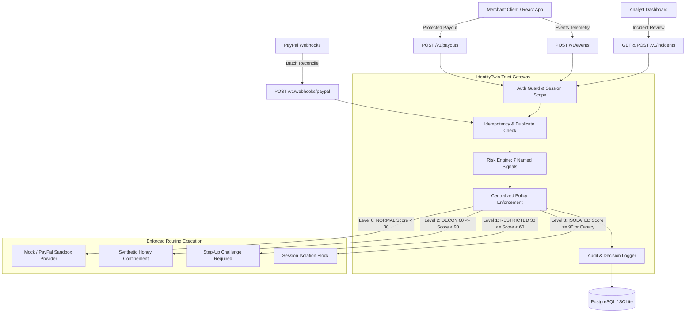

# IdentityTwin — Behavioral Identity & Trust Gateway

> **Hackathon Security Product**: Behavioral identity verification and policy-enforced trust gateway for merchant payment operations.

[](https://www.python.org/)
[](https://fastapi.tiangolo.com/)
[](https://www.sqlalchemy.org/)
[]()
[]()

---

## 1. Executive Summary & Mission

IdentityTwin prevents account takeover, credential stuffing, and unauthorized money movement in merchant payment operations. Instead of treating identity as a binary login check, IdentityTwin continuously assesses behavioral signals (keystroke flight times, mouse trajectories, session anomalies) and routes protected operations through a **centralized Trust Gateway**.

This repository contains the **Backend Foundation and Trust Gateway (Person 1)**:
- Core FastAPI v1 REST application with structured logging and consistent error contracts.
- Centralized gateway routing policy enforcing 4 distinct trust levels.
- Protected payout execution sequence with database-backed idempotency guards.
- Safe payment provider adapter abstractions (`MockPaymentProviderAdapter`, `DecoyHoneyAdapter`, and official `PayPalSandboxAdapter`).
- Shared telemetry ingestion API (`POST /v1/events`) with 7 deterministic behavioral risk signals.
- Inbound PayPal webhook receiver (`POST /v1/webhooks/paypal`) with cryptographic signature verification and reconciliation.
- Incident review and approval APIs with strict Role-Based Access Control (RBAC).
- SQLAlchemy 2.0 models and Alembic migrations.
- Exported OpenAPI specification for frontend and team integration.
- Automated test suite covering all security invariants.

---

## 2. Architecture & Trust Gateway Policy



### Trust Levels & Invariants (PRD Thresholds)

| Trust Level | Risk Score | Payout Action | Routing Destination | Security Invariant |
| :--- | :--- | :--- | :--- | :--- |
| **`NORMAL` (Level 0)** | `0.0 - 29.9` | `ALLOW` | `PROVIDER_MOCK` / `PROVIDER_PAYPAL` | Transaction proceeds to configured provider adapter exactly once. |
| **`RESTRICTED` (Level 1)** | `30.0 - 59.9` | `REQUIRE_STEP_UP` | `RESTRICTED_REJECT` | Payout limit enforced ($500.00). Step-up challenge token required. Never silently bypasses policy. |
| **`DECOY` (Level 2)** | `60.0 - 89.9` | `DECOY_FORWARD` | `DECOY_HONEY` | Routed exclusively to synthetic honey simulator. **Never moves funds or contacts PayPal.** |
| **`ISOLATED` (Level 3)** | `90.0 - 100.0` or Canary | `BLOCK` | `ISOLATED_BLOCK` | Payout blocked immediately. Session revoked/terminated. Auditable Incident recorded. |

---

## 3. Repository Structure

```
IdentityTwin/
├── apps/
│   └── api/
│       ├── app/
│       │   ├── main.py                     # Application factory, lifespan, CORS, middleware
│       │   ├── core/
│       │   │   ├── config.py               # Pydantic BaseSettings, production validation guards
│       │   │   ├── security.py             # AuthenticatedPrincipal, RBAC, dev-auth abstraction
│       │   │   └── exceptions.py           # Custom exception hierarchy & JSON error handler
│       │   ├── api/
│       │   │   ├── router.py               # Assembled API v1 and health routers
│       │   │   └── routes/
│       │   │       ├── health.py           # /health (liveness) & /ready (readiness)
│       │   │       ├── events.py           # POST /v1/events (telemetry ingestion)
│       │   │       ├── payouts.py          # POST /v1/payouts (protected gateway execution)
│       │   │       ├── sessions.py         # GET /v1/sessions & GET /v1/sessions/{id}
│       │   │       └── incidents.py        # GET & POST /v1/incidents (analyst approval)
│       │   ├── schemas/                    # Pydantic request/response schemas
│       │   ├── models/                     # SQLAlchemy 2.0 ORM models
│       │   ├── db/
│       │   │   ├── session.py              # Engine, SessionLocal, get_db, readiness probe
│       │   │   └── repositories/           # Session, Event, Payout, Incident, Idempotency repos
│       │   ├── gateway/
│       │   │   ├── service.py              # Central TrustGatewayService (9-step execution)
│       │   │   ├── policy.py               # Centralized TrustGatewayPolicy routing rules
│       │   │   ├── routing.py              # Routing decision models & destinations
│       │   │   └── provider.py             # MockPaymentProviderAdapter & DecoyHoneyAdapter
│       │   ├── risk/
│       │   │   ├── service.py              # Deterministic baseline risk engine & interface
│       │   │   └── schemas.py              # Risk evaluation models, named signals
│       │   └── services/                   # EventService, IncidentService
│       ├── tests/                          # 48 comprehensive automated tests
│       ├── alembic/                        # Database migration scripts
│       ├── alembic.ini                     # Alembic configuration
│       ├── pyproject.toml                  # Python package configuration & dependencies
│       └── Dockerfile                      # Production container definition
├── packages/
│   └── contracts/
│       ├── README.md                       # Contracts guide for other teammates
│       └── openapi.json                    # Exported OpenAPI 3.1.0 specification
├── docs/
│   ├── architecture.md                     # Architecture specification & Mermaid diagram
│   ├── api-contracts.md                    # Detailed endpoint contracts and JSON payloads
│   ├── security-boundaries.md              # Security boundaries & production roadmap
│   └── local-development.md                # Local setup guide & command reference
├── scripts/
│   ├── seed_demo.py                        # Seeds test merchants, users, sessions, incidents
│   └── export_openapi.py                   # Exports openapi.json from live FastAPI app
├── .env.example                            # Safe environment variable placeholders
├── .gitignore                              # Git exclusion rules
├── docker-compose.yml                      # API and PostgreSQL orchestration
├── Makefile                                # Developer workflow commands
└── README.md
```

---

## 4. Quickstart Guide

### 1. Setup Environment
```bash
cp .env.example .env
make install
```

### 2. Run Migrations & Seed Demo Data
```bash
make migrate
make seed
```

### 3. Start Development Server
```bash
make dev
```
API runs on `http://localhost:8000`.
- Swagger UI: `http://localhost:8000/docs`
- ReDoc: `http://localhost:8000/redoc`
- OpenAPI JSON: `http://localhost:8000/openapi.json`
- Liveness Probe: `http://localhost:8000/health`
- Readiness Probe: `http://localhost:8000/ready`

---

## 5. Automated Tests & Quality Checks

Run the automated test suite across all 48 test scenarios (covering all 15 required security and provider properties):

```bash
make test
```

Run linting and formatting:
```bash
make lint
make format
```

Export OpenAPI contracts without drift:
```bash
make openapi
```

---

## 6. Teammate Handoff & Integration Matrix

| Teammate | Focus Area | Integration Touchpoint | Status |
| :--- | :--- | :--- | :--- |
| **Frontend** | React Dashboard | `packages/contracts/openapi.json` — Generate TypeScript types via `npx openapi-typescript`. | Contract Ready (11 paths) |
| **Person 2** | Risk Intelligence | Implement `IRiskEngineService` in `app/risk/service.py`. Consume `SecurityEvent` telemetry. | 7 Named Signals Connected |
| **Person 3** | PayPal Integration | `PayPalSandboxAdapter` in `app/gateway/provider.py`. Connect PayPal Sandbox credentials in `.env`. | Sandbox Adapter Ready |
| **Person 4** | Honey Workspace | `DecoyHoneyAdapter` in `app/gateway/provider.py`. Confinement routing is automated. | Honey Routing Verified |
| **Person 5** | Evidence & Incidents | Consume `SecurityEvent`, `RiskDecisionRecord`, and `AnalystActionRecord` from database. | Evidence Integrity Ready |
| **Person 6** | AI Investigator | Read incident telemetry via `GET /v1/incidents/{id}`. | Read API Ready |

---

## 7. PayPal Sandbox Integration & Demo Setup

### Configuring Live PayPal Sandbox
To connect live PayPal Sandbox credentials for demo execution:
1. Log in to [PayPal Developer Dashboard](https://developer.paypal.com/dashboard/applications/sandbox).
2. Create or select a REST API Sandbox Application.
3. Copy **Client ID** and **Secret** to your `.env`:
   ```bash
   PAYMENT_PROVIDER="paypal_sandbox"
   PAYPAL_CLIENT_ID="<your_sandbox_client_id>"
   PAYPAL_CLIENT_SECRET="<your_sandbox_client_secret>"
   PAYPAL_WEBHOOK_ID="<your_webhook_id>"
   PAYPAL_BASE_URL="https://api-m.sandbox.paypal.com"
   ```
4. Normal eligible payouts (`TrustLevel.NORMAL`) will automatically execute via official PayPal Payouts REST API (`/v1/payments/payouts`) with `PayPal-Request-Id` idempotency tracking.
5. In the absence of live PayPal credentials, the platform defaults to `PAYMENT_PROVIDER="mock"`, providing safe synthetic transactions without network dependencies.

### Security Invariants & Notes
1. **Never Real Money**: The system is hardcoded to use PayPal Sandbox endpoints (`https://api-m.sandbox.paypal.com`) and synthetic demo data. Under no circumstances are live production credentials or real-money movements permitted.
2. **Development Authentication**: Uses static Bearer tokens and `X-Dev-*` headers for rapid local testing. In production (`ENVIRONMENT=production`), development authentication is strictly rejected; enterprise OIDC/OAuth2 with cryptographic JWKS validation must be configured.
3. **Canary Interaction Protection**: Any canary interaction immediately triggers Level 3 isolation, revokes the user session, and records an auditable incident regardless of initial risk score.


