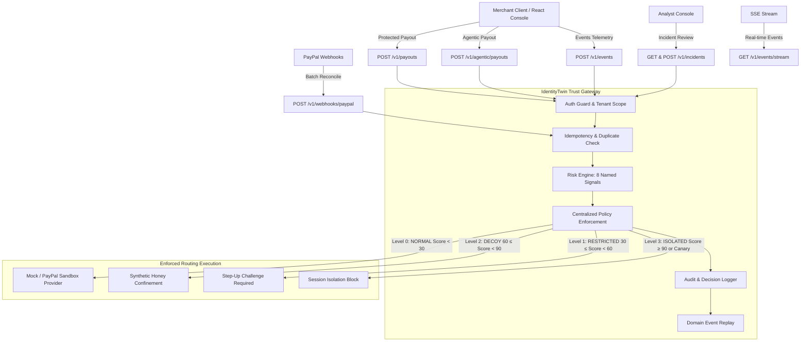

# IdentityTwin — Behavioral Identity & Trust Gateway

> **Behavioral Identity & Trust Gateway** — Continuous behavioral risk assessment and policy-enforced trust gateway for merchant payment operations.

[](https://www.python.org/)
[](https://fastapi.tiangolo.com/)
[](https://www.sqlalchemy.org/)
[](https://react.dev/)
[](https://www.typescriptlang.org/)
[]()
[](https://docs.docker.com/compose/)
[]()

---

## 1. Executive Summary & Mission

IdentityTwin prevents account takeover, credential stuffing, and unauthorized money movement in merchant payment operations. Instead of treating identity as a binary login check, IdentityTwin continuously assesses behavioral signals (keystroke flight times, mouse trajectories, session anomalies, device fingerprints, network origins, payee history, amount baselines) and routes protected operations through a **centralized Trust Gateway** with four enforced trust levels.

This repository contains the complete backend foundation, Trust Gateway, reconciliation workers, and React operations console:

- **Core FastAPI** application with structured logging, consistent error contracts, and OpenAPI 3.1 specification
- **Centralized Trust Gateway** routing policy enforcing 4 distinct trust levels (NORMAL, RESTRICTED, DECOY, ISOLATED)
- **Protected payout execution** with database-backed idempotency guards and exactly-once provider invocation
- **Payment provider adapter abstractions** — `MockPaymentProviderAdapter`, `PayPalSandboxAdapter`, and `DecoyHoneyAdapter`
- **Behavioral telemetry ingestion** (`POST /v1/events`) with 8 deterministic risk signals
- **Inbound PayPal webhook receiver** with cryptographic signature verification and automated reconciliation
- **Incident review & approval APIs** with strict Role-Based Access Control (merchant vs analyst)
- **Honey Workspace** — synthetic decoy environments for suspicious sessions with canary detection
- **Evidence Chain** — hash-chained append-only logs with sealed incident checkpoints
- **Vaccination Signatures** — cross-merchant behavioral attack pattern library
- **Agentic Commerce** — AI agent payout authorization with server-side grant validation
- **Reconciliation Worker** — background payout state reconciliation with `SELECT ... FOR UPDATE SKIP LOCKED` concurrency
- **Durable Domain Events** — tenant-scoped SSE event stream with 30-day retention and cursor replay
- **React 19 + TypeScript Operations Console** — 17 routes covering all product modules
- **649 backend tests** + **20 frontend unit tests** + **12 Playwright E2E tests** = **731 tests passing**

---

## 2. Architecture & Trust Gateway Policy



### Trust Levels & Invariants (PRD Thresholds)

| Trust Level | Risk Score | Payout Action | Routing Destination | Security Invariant |
| :--- | :--- | :--- | :--- | :--- |
| **`NORMAL` (Level 0)** | `0.0 - 29.9` | `ALLOW` | `PROVIDER_MOCK` / `PROVIDER_PAYPAL` | Transaction proceeds to configured provider adapter exactly once. |
| **`RESTRICTED` (Level 1)** | `30.0 - 59.9` | `REQUIRE_STEP_UP` | `RESTRICTED_REJECT` | Payout limit enforced ($500.00). Step-up challenge token required. Never silently bypasses policy. |
| **`DECOY` (Level 2)** | `60.0 - 89.9` | `DECOY_FORWARD` | `DECOY_HONEY` | Routed exclusively to synthetic honey simulator. **Never moves funds or contacts PayPal.** |
| **`ISOLATED` (Level 3)** | `90.0 - 100.0` or Canary | `BLOCK` | `ISOLATED_BLOCK` | Payout blocked immediately. Session revoked/terminated. Auditable Incident recorded. |

### Risk Signals (8 Weighted)

| Signal | Weight | Description |
| :--- | :--- | :--- |
| `NEW_DEVICE` | 18.0 | Device fingerprint not in confirmed baseline |
| `NEW_LOCATION` | 14.0 | Network origin bucket not in confirmed locations |
| `UNUSUAL_TIME` | 11.0 | Action outside confirmed active hours |
| `NEW_PAYEE` | 16.0 | Recipient not previously observed |
| `LARGE_PAYOUT` | 21.0 | Amount exceeds absolute & relative thresholds |
| `NEW_PAYEE_LARGE_PAYOUT` | 9.0 | New payee combined with large payout |
| `PAYEE_ADD_THEN_PAYOUT` | 9.0 | Payee registered and paid within sequence window |
| `CANARY_INTERACTION` | 11.0 | Synthetic resource accessed — forces isolation |

---

## 3. Repository Structure

```
IdentityTwin/
├── apps/
│   └── api/
│       ├── app/
│       │   ├── main.py                     # Application factory, lifespan, CORS, middleware
│       │   ├── core/
│       │   │   ├── config.py               # Pydantic BaseSettings, production validation guards
│       │   │   ├── security.py             # AuthenticatedPrincipal, RBAC, dev-auth abstraction
│       │   │   └── exceptions.py           # Custom exception hierarchy & JSON error handler
│       │   ├── api/
│       │   │   ├── router.py               # Assembled API v1 and health routers
│       │   │   └── routes/                 # 19 route modules
│       │   │       ├── health.py           # /health (liveness) & /ready (readiness)
│       │   │       ├── events.py           # POST /v1/events, GET /v1/events/stream (SSE)
│       │   │       ├── payouts.py          # POST /v1/payouts (gateway execution)
│       │   │       ├── sessions.py         # Session CRUD, activity, step-up
│       │   │       ├── incidents.py        # Incident lifecycle & analyst actions
│       │   │       ├── reconciliation.py   # Analyst reconciliation dashboard
│       │   │       ├── honey_operator.py   # Honey workspace & canary management
│       │   │       ├── evidence.py         # Evidence chain verification & seals
│       │   │       ├── vaccination.py      # Vaccination signatures & matches
│       │   │       ├── agentic.py          # Agentic commerce payouts
│       │   │       ├── risk.py             # Risk config, decisions, evaluation
│       │   │       ├── twin.py             # Behavioral identity profiles
│       │   │       ├── agents.py           # Agent registry & audit
│       │   │       ├── analytics.py        # Dashboard overview metrics
│       │   │       ├── simulation.py       # Attack simulation & calibration
│       │   │       ├── intent.py           # Intent profiler snapshots
│       │   │       ├── investigation.py    # AI investigation bundles
│       │   │       ├── system.py           # System context & capabilities
│       │   │       ├── webhooks.py         # PayPal webhook receiver
│       │   │       └── stubs.py            # Development stubs
│       │   ├── schemas/                    # Pydantic request/response schemas (200+)
│       │   ├── models/                     # SQLAlchemy 2.0 ORM models (27 tables)
│       │   ├── db/
│       │   │   ├── session.py              # Engine, SessionLocal, get_db, readiness
│       │   │   └── repositories/           # Session, Event, Payout, Incident, Idempotency, Agent, Honey repos
│       │   ├── gateway/
│       │   │   ├── service.py              # TrustGatewayService (9-step execution)
│       │   │   ├── agentic.py              # Internal agentic commerce adapter
│       │   │   ├── policy.py               # Centralized TrustGatewayPolicy
│       │   │   ├── routing.py              # Routing decision models
│       │   │   ├── provider.py             # Mock, PayPal Sandbox & honey decoy adapters
│       │   │   ├── reconciliation_worker.py # Background reconciliation (asyncio)
│       │   │   ├── isolation.py            # Session isolation & incident opening
│       │   │   └── ratelimit.py            # In-memory rate limiting
│       │   ├── risk/
│       │   │   ├── service.py              # Deterministic risk engine
│       │   │   └── schemas.py              # Risk evaluation models
│       │   ├── honey/
│       │   │   ├── events.py               # Domain event streaming & cursors
│       │   │   ├── service.py              # Honey workspace management
│       │   │   └── bootstrap.py            # Canary seeding & workspace init
│       │   ├── evidence/
│       │   │   └── hashchain.py            # SHA-256 hash chain & verification
│       │   ├── investigation/
│       │   │   ├── service.py              # AI investigation (read-only, advisory)
│       │   │   ├── llm.py                  # Optional LLM narrative (disabled by default)
│       │   │   └── extraction.py           # Evidence redaction & bundling
│       │   └── services/                   # EventService, IncidentService, VaccinationService
│       ├── tests/                          # 649 backend tests
│       ├── alembic/                        # 19 database migration scripts
│       ├── alembic.ini                     # Alembic configuration
│       ├── pyproject.toml                  # Python package configuration
│       └── Dockerfile                      # Production container definition
├── frontend/
│   ├── src/
│   │   ├── app.tsx                         # Authenticated route map (17 routes)
│   │   ├── pages/                          # Module and detail pages
│   │   ├── features/                       # Payout, incident, agent, evidence workflows
│   │   ├── components/                     # App shell, states, accessible UI primitives
│   │   ├── lib/                            # API client, auth, SSE, React Query, formatting
│   │   └── types/api.ts                    # Generated from OpenAPI spec
│   ├── e2e/console.spec.ts                 # 12 Playwright E2E tests
│   ├── playwright.config.ts                # Isolated E2E API + disposable DB
│   ├── vite.config.ts                      # Vite + Vitest + React 19 config
│   └── Dockerfile                          # Multi-stage nginx production build
├── packages/
│   └── contracts/
│       ├── README.md                       # Contracts guide
│       └── openapi.json                    # Exported OpenAPI 3.1 specification
├── docs/
│   ├── architecture.md                     # Architecture specification
│   ├── agentic-commerce.md                 # Internal agentic commerce contract
│   ├── api-contracts.md                    # Detailed endpoint contracts
│   ├── security-boundaries.md              # Security boundaries & production roadmap
│   ├── honey-and-evidence.md               # Honey workspace & evidence chain
│   ├── ai-investigator.md                  # AI Investigator (Person 6) design
│   ├── local-development.md                # Local setup guide
│   └── deployment.md                       # Docker deployment guide
├── scripts/
│   ├── seed_demo.py                        # Seeds demo merchants, users, sessions, incidents
│   ├── export_openapi.py                   # Exports openapi.json from live app
│   └── docker/                             # Docker entrypoint scripts (nginx, squid)
├── .env.example                            # Safe environment variable placeholders
├── .gitignore
├── docker-compose.yml                      # API, PostgreSQL, gateway, proxy, console
├── Makefile                                # Developer workflow commands
├── PORT_AUDIT_REPORT.md                    # Port audit findings
├── BACKEND_HEALTH_REPORT.md                # Backend health check
├── DATABASE_HEALTH_REPORT.md               # Database & migration status
├── API_ENDPOINT_AUDIT.md                   # 243 endpoint inventory
├── FRONTEND_HEALTH_REPORT.md               # Frontend health check
├── FRONTEND_BACKEND_INTEGRATION_REPORT.md  # Integration contract verification
├── SSE_REALTIME_AUDIT.md                   # SSE lifecycle verification
├── WORKER_HEALTH_REPORT.md                 # Background worker health
├── RUNTIME_SECURITY_AUDIT.md               # 18 security invariants verified
├── EXTERNAL_INTEGRATION_REPORT.md          # PayPal & AI integration status
├── FULL_SYSTEM_TEST_REPORT.md              # Complete test execution report
├── RESOURCE_PERFORMANCE_REPORT.md          # Resource & performance metrics
├── SYSTEM_FINDINGS_AND_REMEDIATION_PLAN.md # 15 findings with priorities
└── IDENTITYTWIN_SYSTEM_HEALTH_FINAL_REPORT.md # Consolidated audit verdict
```

---

## 4. Quickstart Guide

### 1. Setup Environment
```bash
cp .env.example .env
make install
```
`make install` creates `.venv` and installs the API package in editable mode (`pip install -e "apps/api[dev]"`). Manual alternative:
```bash
cd apps/api && python -m pip install -e ".[dev]"
```

### 2. Run Migrations & Seed Demo Data
```bash
make migrate
make seed
```

### 3. Start Development Server
```bash
make dev
```
API runs on `http://localhost:8000`:
- Swagger UI: `http://localhost:8000/docs`
- ReDoc: `http://localhost:8000/redoc`
- OpenAPI JSON: `http://localhost:8000/openapi.json`
- Liveness Probe: `http://localhost:8000/health`
- Readiness Probe: `http://localhost:8000/ready`

### 4. Start the React Console
Requires Node.js 22+. In a second terminal:
```bash
cd frontend
npm install
npm run dev
```
Console runs on `http://127.0.0.1:5173` and proxies `/v1` to the API. Use the development personas on the login page.

---

## 5. Docker Compose Deployment (Verified)

```bash
docker compose up -d
```

Builds and starts: **API**, **PostgreSQL**, **nginx Gateway**, **Squid PayPal egress proxy**, **React Console**.

### Verified Behavior
- All services become healthy: `db`, `api`, `gateway`, `console`, `paypal-egress`
- Health checks: `GET /health` and `GET /ready` (via gateway) return 200; `/ready` reports `database: connected`
- API connects to PostgreSQL over private Docker network via `db:5432` — **PostgreSQL not published to host**
- On API startup: `alembic upgrade head` runs, then `scripts/seed_demo.py` populates demo data (idempotent)
- Host ports: gateway `127.0.0.1:8001→8000`, console `127.0.0.1:3001→80`
- Override with `IDENTITYTWIN_API_PORT` and `IDENTITYTWIN_CONSOLE_PORT`
- Use `docker compose down` (volume-preserving) or `docker compose stop`/`start` — **avoid `down -v`**

### PayPal Sandbox Access
PayPal reachable through Squid egress proxy (`paypal-egress:3128` → `api-m.sandbox.paypal.com:443` only). Select `PAYMENT_PROVIDER=paypal_sandbox` with valid credentials to exercise real provider; default `PAYMENT_PROVIDER=mock` requires no credentials.

---

## 6. Automated Tests & Quality Checks

### Backend
```bash
make test
# or
cd apps/api && python -m pytest -v
```
**649 tests pass** covering: risk engine contracts, gateway routing, payout execution, reconciliation worker, security invariants, PayPal provider, webhook verification, evidence chain, honey workspace, agentic commerce, behavioral twins, vaccination signatures, AI investigator, intent profiler, authorization, step-up, sessions, events, incidents, simulation, health, config.

### Frontend
```bash
cd frontend
npm run typecheck    # TypeScript strict mode
npm run lint         # ESLint
npm test             # 20 Vitest unit tests
npm run build        # Vite production build
npm run test:e2e     # 12 Playwright E2E tests (isolated API on :8010, Vite on :5174, disposable SQLite)
```

### Linting & Formatting
```bash
make lint
make format
```

### Contract Export
```bash
make openapi                    # Exports OpenAPI spec
cd frontend && npm run openapi:types  # Regenerates TypeScript types
```

---

## 7. System Health Status (Audit 2026-11-07)

### Overall Verdict: **SYSTEM DEGRADED**
- Core application **fully functional** for development/staging
- **2 blockers** prevent production release

| Component | Status |
|-----------|--------|
| Frontend | ✅ PASS |
| Backend | ✅ PASS |
| PostgreSQL | ✅ PASS |
| Authentication | ⚠️ Dev-only (OIDC returns 501) |
| API Endpoints (243) | ✅ PASS |
| Gateway & Trust Engine | ✅ PASS |
| Honey Workspace | ✅ PASS |
| Canary Service | ✅ PASS |
| Evidence Chain | ✅ PASS |
| Payment Service | ⚠️ Mock only |
| PayPal Integration | 🔴 **BLOCKED** (INT-005) |
| Reconciliation Worker | ✅ PASS |
| SSE Realtime | ✅ PASS |
| Monitoring | ❌ Not configured |

### Test Baselines Met
- Backend: **649/649** ✅
- Frontend Unit: **20/20** ✅
- Frontend E2E: **12/12** ✅
- Reconciliation: **13/13** ✅
- Security Invariants: **18/18** ✅
- Migrations: **19/19** (head: `019_durable_domain_events`) ✅

### Critical Blockers
| ID | Blocker | Resolution |
|----|---------|------------|
| **INT-005** | PayPal Sandbox verification | Provision Sandbox receiver account, execute controlled payout |
| **FIND-002** | OIDC production auth returns 501 | Implement JWKS client + JWT validation + claim extraction |

### Key Findings (15 total)
- **P0**: 1 (PayPal Sandbox)
- **P1**: 1 (OIDC auth)
- **P2**: 5 (Bundle size, observability, escalation alerts, slow queries, distributed rate limiting)
- **P3**: 8 (Fast Refresh, test infra, secret rotation, SSE heartbeat, query invalidation, DNS rebinding, router warnings, stale container)

See [`SYSTEM_FINDINGS_AND_REMEDIATION_PLAN.md`](SYSTEM_FINDINGS_AND_REMEDIATION_PLAN.md) for complete remediation plan.

---

## 8. Teammate Integration Matrix

| Focus Area | Integration Touchpoint | Status |
| :--- | :--- | :--- |
| **Frontend / Console** | `frontend/` consumes `packages/contracts/openapi.json` via generated TypeScript types; 17 routes, 47 API methods | ✅ Delivered |
| **Risk Intelligence** (Person 2) | `IRiskEngineService` in `app/risk/service.py`; 8 named signals | ✅ Connected |
| **PayPal Integration** (Person 3) | `PayPalSandboxAdapter` in `app/gateway/provider.py`; `POST /v1/agentic/payouts` | ⚠️ Mock only (INT-005) |
| **Honey Workspace** (Person 4) | `DecoyHoneyAdapter`; workspace, canaries, containment, evidence | ✅ Verified |
| **Evidence & Incidents** (Person 5) | `SecurityEvent`, `RiskDecisionRecord`, `AnalystActionRecord` from DB | ✅ Implemented |
| **AI Investigator** (Person 6) | Read-only advisory API; deterministic extraction; optional LLM disabled by default | ✅ Advisory only |

---

## 9. PayPal Sandbox Integration Status

### Configuration
```bash
PAYMENT_PROVIDER="paypal_sandbox"
PAYPAL_CLIENT_ID="<your_sandbox_client_id>"
PAYPAL_CLIENT_SECRET="<your_sandbox_client_secret>"
PAYPAL_WEBHOOK_ID="<your_webhook_id>"
PAYPAL_BASE_URL="https://api-m.sandbox.paypal.com"
```

### Security Boundaries
- `PAYPAL_BASE_URL` **validated at startup** against explicit allowlist (`api-m.sandbox.paypal.com` only)
- Rejects: production hosts, lookalikes, legacy hosts, non-https, credentials, non-default ports, paths
- `PAYMENT_PROVIDER` validated: only `mock` or `paypal_sandbox` accepted
- Selecting `paypal_sandbox` without credentials **aborts startup**

### Current Status
| Component | Status |
|-----------|--------|
| Sandbox URL Allowlist | ✅ Enforced |
| Credential Validation | ✅ Startup guard |
| Mock Provider | ✅ 54 tests pass |
| PayPal Adapter Code | ✅ Implemented |
| Webhook Verification | ✅ 36 tests pass (mock signatures) |
| Egress Proxy (Squid) | ✅ Running |
| **Real Sandbox Test** | 🔴 **INT-005 BLOCKED** — No receiver account |

> **Note**: All 54 PayPal tests pass using mock provider. Real PayPal Sandbox verification requires an approved Sandbox business account with receiver permissions. See `EXTERNAL_INTEGRATION_REPORT.md` for details.

---

## 10. Agentic Commerce Integration

AI agents have **no privilege of their own** — requests are normalized into canonical Trust Gateway requests.

```
Agent request → internal adapter (authorize + normalize) → Trust Gateway → Provider / Honey / Block
```

- **Endpoint**: `POST /v1/agentic/payouts`
- **Adapter**: `AgenticCommerceAdapter` / `AgenticCommerceService` in `app/gateway/agentic.py`
- **Contract**: `docs/agentic-commerce.md`

### Guarantees
1. **No bypass to PayPal** — agentic path contains no provider adapter import
2. **Fail-closed authorization** — unknown/expired/revoked grants rejected before provider call
3. **Risk parity** — RESTRICTED→step-up, DECOY→honey, ISOLATED→block+incident
4. **Idempotency preserved** — caller's key forwarded, isolated from human payouts
5. **Full attribution** — every attempt in `agentic_commerce_audit`

### Demo
```bash
make migrate && make seed  # seeds demo agent 7777... with grant 8888...
curl -X POST http://localhost:8000/v1/agentic/payouts \
  -H "Authorization: Bearer dev-merchant-token" -H "Content-Type: application/json" \
  -d '{"agent_id":"77777777-7777-7777-7777-777777777777",
       "authorization_grant_id":"88888888-8888-8888-8888-888888888888",
       "session_id":"22222222-2222-2222-2222-222222222222",
       "recipient_email":"vendor@example.com","amount":120.00,
       "currency":"USD","idempotency_key":"agentic-order-8842"}'
```

---

## 11. Security Posture

### 18 Mandatory Invariants — All Verified ✅
1. No debug mode in production (`ENVIRONMENT=production` → `ALLOW_DEV_AUTH=false`)
2. No development secrets in production (entropy validation on `CANARY_HMAC_SECRET`, `EVIDENCE_HMAC_KEY`)
3. Database not publicly exposed (internal Docker network only)
4. No unintended admin endpoint exposure (analyst role required)
5. Correct CORS origins (localhost:3000, localhost:5173)
6. Correct authentication (Bearer + dev headers on all `/v1/*`)
7. Correct RBAC (merchant vs analyst separation)
8. Tenant isolation (cross-merchant requests return 403/empty)
9. Session ownership (payout/session/incident scoped to principal)
10. Rate limiting (global IP + auth endpoints)
11. Secure cookies (N/A — Bearer tokens)
12. Webhook signature validation (PayPal HMAC, fail-closed)
13. No sensitive values in logs (structured sanitization)
14. No exposed canary secrets (redacted in list views)
15. No demo credentials in production (dev tokens rejected)
16. No mock provider in production (blocked unless explicit override)
17. Honey/DECOY/ISOLATED never invoke payment provider (7 no-bypass tests)
18. Evidence integrity (hash chain append-only, seals verify)

---

## 12. Known Limitations

1. **OIDC Production Auth** — Returns 501; requires JWKS/JWT implementation
2. **PayPal Sandbox** — INT-005 blocked; no receiver account for controlled payout
3. **Observability** — No Prometheus metrics, OpenTelemetry, or log aggregation
4. **Frontend Bundle** — 1.3 MB main chunk; code splitting recommended
5. **Rate Limiting** — In-memory only; not distributed across replicas
6. **SSE Heartbeat** — No periodic ping; may be closed by intermediaries
7. **Reconciliation Alerts** — Stuck payouts only logged, not alerted
8. **Secret Rotation** — No automated procedure for HMAC keys

See [`docs/KNOWN_LIMITATIONS.md`](docs/KNOWN_LIMITATIONS.md) and [`SYSTEM_FINDINGS_AND_REMEDIATION_PLAN.md`](SYSTEM_FINDINGS_AND_REMEDIATION_PLAN.md) for full details.

---

## 13. License

MIT License — see [`LICENSE`](LICENSE) for details.

---

*Last updated: 2026-11-07 | Release Candidate: 593b048f8da5bf77868aa9af2e1e4f12a0c7f155 | Audit: SYSTEM DEGRADED*