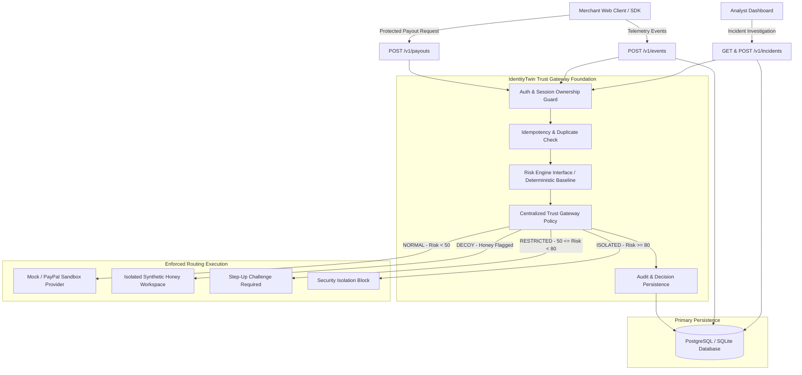

# IdentityTwin Architecture Specification

IdentityTwin provides a behavioral identity verification and trust gateway for merchant payment operations. It intercepts sensitive merchant actions (such as high-value payouts and credential changes), evaluates behavioral anomalies in real-time, and enforces strict, centralized routing policies.

## 1. System Architecture Overview

---

## 2. Trust Level States and Enforced Invariants

The gateway defines four authoritative, mutually exclusive trust levels:

| Trust Level | Score Range | Payout Action | Gateway Routing Destination | Invariant Guarantee |
| :--- | :--- | :--- | :--- | :--- |
| **NORMAL** | `0.0 - 49.9` | `ALLOW` | `PROVIDER_MOCK` / `PROVIDER_PAYPAL` | Payout proceeds to configured payment provider. Transaction is executed exactly once. |
| **RESTRICTED**| `50.0 - 79.9`| `REQUIRE_STEP_UP` | `RESTRICTED_REJECT` | Payout is rejected by default. **Never touches the PayPal provider adapter.** Step-up MFA required. |
| **DECOY** | N/A (Flagged)| `DECOY_FORWARD` | `DECOY_HONEY` | Routed exclusively to synthetic honey environment. **Never moves funds or contacts PayPal.** Attacker is deceived in confinement. |
| **ISOLATED** | `80.0 - 100.0`| `BLOCK` | `ISOLATED_BLOCK` | Payout is blocked immediately. Further sensitive operations are denied. **Never touches the PayPal adapter.** |

### Critical Invariants:
1. **Server-Enforced Trust Authority**: The frontend, request payload, or an LLM cannot choose or tamper with the effective trust level. Client-supplied trust levels or risk scores are rejected by structural validation and ignored by gateway policy.
2. **Provider Isolation**: Under `RESTRICTED`, `DECOY`, or `ISOLATED` states, the payment provider adapter is never invoked. Automated tests assert that adapter invocation count remains zero.
3. **Session Ownership & Merchant Boundary**: Every event and payout is server-validated against the authenticated principal's merchant ID and user ID. Cross-merchant access is rejected with HTTP 403 Forbidden.
4. **Idempotency**: All payout executions require an idempotency key. Duplicate requests return cached responses and cannot trigger duplicate payment executions.

---

## 3. Core Component Boundaries

### A. Centralized Gateway Policy (`gateway/policy.py`)
All routing rules reside in a single module. No route handler contains branching business logic for trust levels. The policy accepts a `RiskEvaluationResult` and returns a `GatewayRoutingDecision`.

### B. Payment Provider Adapter (`gateway/provider.py`)
Provides an abstraction (`IPaymentProviderAdapter`) separating payment network calls from gateway enforcement:
- `MockPaymentProviderAdapter`: Emits synthetic references (`SYNTH-MOCK-TXN-...`) and tracks invocation counts for automated testing.
- `DecoyHoneyAdapter`: Simulates synthetic responses (`HONEY-DECOY-SIM-TXN-...`) for honey workspace deception.

### C. Risk Engine Interface (`risk/service.py`)
Provides an injectable `IRiskEngineService` interface. The foundation implementation provides a deterministic baseline score (default 0.0, with high-value checks). The Risk Intelligence teammate can plug in machine learning models or behavioral biometrics without altering the API or gateway contracts.

### D. Incident Management (`services/incident_service.py`)
Provides audit-logged approval and resolution workflows. **An incident approval does not automatically execute payouts, override trust decisions, or disable isolation.** It records analyst justifications and updates review status.
