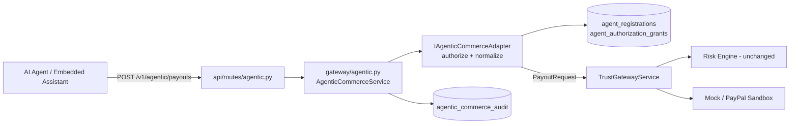

# IdentityTwin Architecture Specification

IdentityTwin provides a behavioral identity verification and trust gateway for merchant payment operations. It intercepts sensitive merchant actions (such as high-value payouts and credential changes), evaluates behavioral anomalies in real-time, and enforces strict, centralized routing policies.

## 1. System Architecture Overview

---

## 2. Trust Level States and Enforced Invariants

The gateway defines four authoritative, mutually exclusive trust levels:

| Trust Level | Score Range | Payout Action | Gateway Routing Destination | Invariant Guarantee |
| :--- | :--- | :--- | :--- | :--- |
| **NORMAL** | `0.0 - 29.9` | `ALLOW` | `PROVIDER_MOCK` / `PROVIDER_PAYPAL` | Payout proceeds to configured payment provider. Transaction is executed exactly once. |
| **RESTRICTED**| `30.0 - 59.9`| `REQUIRE_STEP_UP` | `RESTRICTED_REJECT` | Payout is rejected by default. **Never touches the PayPal provider adapter.** Step-up MFA required. |
| **DECOY** | `60.0 - 89.9` (Flagged)| `DECOY_FORWARD` | `DECOY_HONEY` | Routed exclusively to synthetic honey environment. **Never moves funds or contacts PayPal.** Attacker is deceived in confinement. |
| **ISOLATED** | `90.0 - 100.0`| `BLOCK` | `ISOLATED_BLOCK` | Payout is blocked immediately. Further sensitive operations are denied. **Never touches the PayPal adapter.** |

### Critical Invariants:
1. **Server-Enforced Trust Authority**: The frontend, request payload, or an LLM cannot choose or tamper with the effective trust level. Client-supplied trust levels or risk scores are rejected by structural validation and ignored by gateway policy.
2. **Provider Isolation**: Under `RESTRICTED`, `DECOY`, or `ISOLATED` states, the payment provider adapter is never invoked. Automated tests assert that adapter invocation count remains zero.
3. **Session Ownership & Merchant Boundary**: Every event and payout is server-validated against the authenticated principal's merchant ID and user ID. Cross-merchant access is rejected with HTTP 403 Forbidden.
4. **Idempotency**: All payout executions require an idempotency key. Duplicate requests return cached responses and cannot trigger duplicate payment executions.

---

## 3. Core Component Boundaries

### A. Centralized Gateway Policy (`gateway/policy.py`)
All routing rules reside in a single module. No route handler contains branching business logic for trust levels. The policy accepts a `RiskEvaluationResult` and returns a `GatewayRoutingDecision`.

### B. Payment Provider Adapter (`gateway/provider.py`)
Provides an abstraction (`IPaymentProviderAdapter`) separating payment network calls from gateway enforcement:
- `MockPaymentProviderAdapter`: Emits synthetic references (`SYNTH-MOCK-TXN-...`) and tracks invocation counts for automated testing.
- `DecoyHoneyAdapter`: Simulates synthetic responses (`HONEY-DECOY-SIM-TXN-...`) for honey workspace deception.

### C. Risk Engine Interface (`risk/service.py`)
Provides an injectable `IRiskEngineService` interface. The foundation implementation provides a deterministic baseline score (default 0.0, with high-value checks). The Risk Intelligence teammate can plug in machine learning models or behavioral biometrics without altering the API or gateway contracts.

### D. Incident Management (`services/incident_service.py`)
Provides audit-logged approval and resolution workflows. **An incident approval does not automatically execute payouts, override trust decisions, or disable isolation.** It records analyst justifications and updates review status.

---

## 4. Behavioral Identity Twin (Person 2 - Risk Intelligence)

The twin engine sits behind the same `IRiskEngineService` interface and is registered as the default implementation, so the gateway policy, the API surface and the provider isolation invariant are unchanged.

### A. Components

| Component | Location | Responsibility |
| :--- | :--- | :--- |
| Deterministic engine | `app/risk/engine.py` | Scores one event against the identity twin, owns decay, latching and the learning policy. |
| Feature derivation | `app/risk/features.py` | Derives every feature server-side (device digest, location bucket, hour of day, payee, amount). **Client supplied risk flags are never trusted.** |
| Twin model | `app/risk/twin.py` | Pure baseline: sample count, confirmed devices/locations/payees, hour histogram, amount average. |
| Sequences | `app/risk/sequences.py` | Detects multi-event patterns inside a session (payee added then paid, canary interaction). |
| Session ledger | `app/risk/session_state.py` | Durable per-session score, latched signals, decay bookkeeping and the contribution ledger. |
| Twin viewer API | `app/api/routes/twin.py` | `GET /v1/identities/{id}/twin` - baseline and optional live session deviation, strictly merchant scoped. |

### B. Scoring contract

Signal weights are part of the published contract and are frozen (see `tests/risk/test_contract.py`):

| Signal | Points | Signal | Points |
| :--- | --- | :--- | --- |
| `NEW_DEVICE` | 18 | `LARGE_PAYOUT` | 21 |
| `NEW_LOCATION` | 14 | `NEW_PAYEE_LARGE_PAYOUT` | 9 |
| `UNUSUAL_TIME` | 11 | `PAYEE_ADD_THEN_PAYOUT` | 9 |
| `NEW_PAYEE` | 16 | `CANARY_INTERACTION` | 11 |

Trust bands use the same thresholds as the gateway policy: `RESTRICTED` at `30`, `DECOY` at `60`, `ISOLATED` at `90`. A canary interaction is forced to `ISOLATED` and its points never decay.

### C. Twin learning policy

* The amount average, the hour histogram and the sample count are learned only from events that carry no hostile signal.
* Device, location and payee observations are counted separately and join the confirmed baseline after `RISK_CONTEXT_CONFIRM_OBSERVATIONS` (2) observations, so a legitimate second phone or second office is not flagged forever.
* Only events whose sole finding is context newness **and** that keep the session below the action threshold may count towards those observations. A hostile session therefore never confirms its own device, location or payee.
* A twin with fewer than `RISK_MIN_SAMPLES` (10) observations is provisional: newness findings are attenuated by `RISK_PROVISIONAL_FACTOR` (0.25).

### D. Tunable settings

| Setting | Default | Meaning |
| :--- | :--- | :--- |
| `RISK_MIN_SAMPLES` | `10` | Observations before the twin is trusted (provisional attenuation below). |
| `RISK_PROVISIONAL_FACTOR` | `0.25` | Attenuation applied to newness findings on a provisional twin. |
| `RISK_LARGE_PAYOUT_THRESHOLD` | `5000.0` | Absolute floor for `LARGE_PAYOUT`. |
| `RISK_LARGE_PAYOUT_RELATIVE_FACTOR` | `3.0` | A payout is large only when it also reaches this multiple of the identity average. |
| `RISK_AMOUNT_BASELINE_MIN_SAMPLES` | `1` | Amount observations required before the relative check applies. |
| `RISK_HOUR_CONFIRM_OBSERVATIONS` | `2` | Observations before an hour of day joins the active hours. |
| `RISK_HOUR_CONCENTRATION_MIN` | `0.25` | Minimum share of activity in the busiest hour before the hour model is used. |
| `RISK_CONTEXT_CONFIRM_OBSERVATIONS` | `2` | Observations before a device/location/payee is confirmed. |
| `RISK_SEQUENCE_WINDOW_SECONDS` | `600` | Window for multi-event sequence detection. |
| `RISK_DECAY_POINTS_PER_EVENT` | `5.0` | Points removed by one eligible benign event. |

Calibration evidence for these settings is in [`docs/calibration-report.md`](calibration-report.md).

---

## 6. Agentic Commerce (Person 3 - Internal Adapter)

AI agent traffic is a **shape transformation problem**, not a new trust path. The
agentic adapter lives inside the gateway boundary and converts an agent shaped
request into the canonical `PayoutRequest`; everything after that point is the
existing Trust Gateway pipeline.

### A. Components

| Component | File | Responsibility |
| :--- | :--- | :--- |
| `IAgenticCommerceAdapter` | `gateway/agentic.py` | Internal adapter protocol: `authorize()` + `normalize()`. |
| `AgenticCommerceAdapter` | `gateway/agentic.py` | Resolves the agent and its delegation, fails closed, normalizes to `PayoutRequest`. |
| `AgenticCommerceService` | `gateway/agentic.py` | Orchestrates authorize -> normalize -> gateway -> audit. |
| `AgentRegistration`, `AgentAuthorizationGrant`, `AgenticCommerceAudit` | `models/agent.py` | Registry, delegation and audit trail. |
| `AgentRepository` | `db/repositories/agent_repo.py` | Persistence for the three tables. |
| `POST /v1/agentic/payouts` | `api/routes/agentic.py` | HTTP surface; depends on the service only. |

### B. Boundary rules

1. The agentic route imports the gateway service, never a provider adapter.
2. `normalize()` is a pure transformation: it preserves the session identity and
   the caller supplied idempotency key, and never introduces a merchant id.
3. The merchant identity is resolved by the Trust Gateway from the
   `AuthenticatedPrincipal`; the agent cannot assert it.
4. The risk engine (Person 2) is untouched: agent requests are scored by the
   same `IRiskEngineService` implementation as human payouts.
5. Failures are fail-closed: an unknown agent, a foreign delegation, an
   expired/revoked/consumed grant, a missing scope or an amount above the
   delegated ceiling all stop the request before any provider call.

The full contract, error codes and the idempotency context isolation rules are
documented in [`docs/agentic-commerce.md`](agentic-commerce.md). The Person 3
completion audit, including the tested-versus-live PayPal boundary, is in
[`docs/p3-paypal-integration-handoff.md`](p3-paypal-integration-handoff.md).
