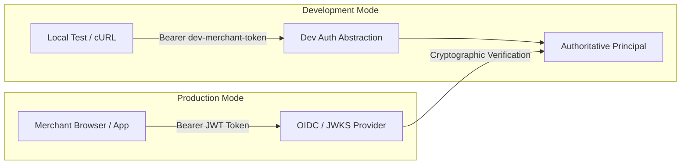

# IdentityTwin Security Boundaries and Threat Model

This document defines the security boundaries of the IdentityTwin Trust Gateway, detailing what it protects, what falls outside its interception surface, and guidelines for production deployment.

---

## 1. Protected Security Perimeter

The Trust Gateway acts as the authoritative control checkpoint for all sensitive financial operations. It actively protects:

### A. Protected Payment Operations (`POST /v1/payouts`)
- **Single Chokepoint Enforcement**: All money movement operations MUST pass through `TrustGatewayService`. No individual route handler, background worker, or external script has direct access to the payment provider adapter.
- **Provider Isolation Invariant**: Under non-eligible trust levels (`RESTRICTED`, `DECOY`, `ISOLATED`), payment provider adapters (PayPal / banking rails) are physically prevented from executing.
- **Idempotency Execution Guard**: Protects against double-spend, network retry duplicates, and replay attacks via database-backed hash and unique key checks.
- **Payload Tampering Protection**: If a client replays an existing idempotency key with modified amounts, currencies, or recipients, the request is rejected with `IDEMPOTENCY_KEY_PAYLOAD_MISMATCH`.
- **Post-Provider Crash Safety**: If a database error occurs after the payment provider executes, the idempotency record is locked to `provider_executed`. Subsequent retries are strictly blocked from re-invoking the provider, preventing double payout executions.
- **Fail-Closed Corrupt Trust Handling**: Sessions with unrecognized, invalid, or tampered trust states fail-closed to `ISOLATED` and block all protected transactions.

### B. Session and Identity Authorization
- **Authoritative Principal Resolution**: The caller's merchant scope, user ID, and role are resolved exclusively through server-validated authentication tokens.
- **Ownership Verification**: Requests claiming to act on a session are checked against `session.merchant_id == principal.merchant_id` and `session.user_id == principal.user_id`. Mismatched ownership results in immediate HTTP 403 Forbidden.
- **Anti-Tampering Guard**: Clients cannot supply `trust_level`, `risk_score`, or `routing_destination` in request bodies. Pydantic schemas enforce `extra="forbid"`, and policy evaluation calculates trust independently.
- **Dev Auth Hardening**: `X-Dev-*` headers cannot bypass token requirements; unauthenticated requests without recognized bearer tokens are rejected with HTTP 401.

### C. Incident & Investigation Integrity
- **Role-Based Access Control (RBAC)**: Only principals with the `analyst` or `admin` role may approve or resolve security incidents. Merchants cannot self-approve incidents.
- **Cross-Merchant Isolation**: Analysts are strictly scoped to their assigned merchant domain. Cross-merchant approval attempts are blocked.
- **Non-Execution Invariant**: Incident approval only updates the review state and audit log; it does NOT automatically disengage isolation or execute payouts.

---

## 2. Boundaries and Non-Intercepted Surfaces

The Trust Gateway is an application-level security control for payment and identity trust. It does **NOT** intercept:

1. **Direct Bank / Provider Inbound Webhooks**: Inbound PayPal or banking notifications should terminate at a dedicated webhook verification service before updating IdentityTwin session states.
2. **Infrastructure-Level DDoS / Layer 4 Attacks**: Volumetric DDoS mitigation must be handled upstream by a WAF / reverse proxy (Cloudflare, AWS CloudFront, or NGINX).
3. **Internal Database Direct Access**: Database credentials must be protected at the network layer with PostgreSQL VPC security groups and TLS encryption.
4. **Offline Hardware Theft**: Physical device theft without biometric session anomaly detection falls to endpoint mobile device management (MDM).

---

## 3. Authentication Abstraction and Production Transition

### Local Development Authentication
To enable frictionless local development and cross-role automated testing without external OAuth providers:
- `ALLOW_DEV_AUTH=true` is permitted **only** when `ENVIRONMENT=development`.
- Development tokens (`dev-merchant-token`, `dev-analyst-token`) or `X-Dev-*` headers simulate authenticated principals.

### Production Security Guards
- **Strict Startup Guard**: `apps/api/app/core/config.py` enforces that if `ENVIRONMENT=production`, `ALLOW_DEV_AUTH` must be `false` and SQLite connection strings are rejected.
- **Production OIDC Hook**: In production, `get_current_principal` verifies JWT bearer tokens signed by an enterprise OIDC/OAuth2 identity provider (e.g., Auth0, Okta, AWS Cognito, Google Cloud Identity) using cryptographic JWKS validation.

---

## 4. Credential and Data Privacy Guarantees

- **No Secret / Token Persistence**: Raw passwords, API secrets, and Bearer tokens are never stored in database tables or logs.
- **Sanitized Request Logging**: The logging middleware intercepts all HTTP requests and logs timing, method, URL path, and client IP, but explicitly redacts request headers (`Authorization`) and request body payloads.
- **Synthetic Test Mock**: `MockPaymentProviderAdapter` generates explicit `SYNTH-MOCK-TXN-...` identifiers with clear simulation warnings. It never claims real money moved.
